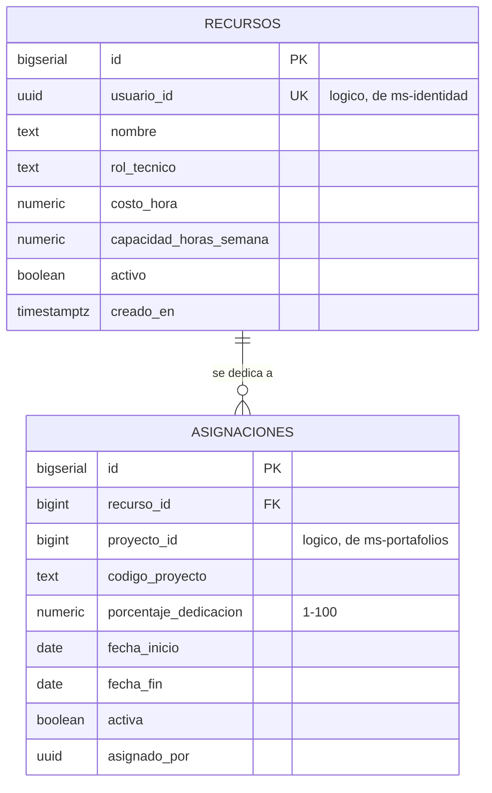

# Modelo de datos — ms-recursos

**Motor:** PostgreSQL en el RDS compartido · **Database:** `ppm_recursos`
**Schemas:** `t_acme`, `t_globex`, `t_initech` — uno por tenant
(patrón **Single Database, Multiple Schemas**)

## Qué es un "recurso" aquí

Las personas de la organización vistas como **capacidad de trabajo asignable**:
cuántas horas tienen por semana y cuánto cuesta su hora. No es un directorio de
perfiles ni una red de contactos — es el insumo para responder *¿quién puede
tomar más trabajo?* y *¿quién está quemado?*

## Diagrama entidad-relación



## La vista `carga`: el Workload del producto

Es la vista que tienen monday, Smartsheet y Planview: cada persona con su
porcentaje de ocupación, en rojo si pasa del 100%.

```sql
SELECT nombre, ocupacion_pct, disponible_pct, sobreasignado
FROM   carga WHERE activo ORDER BY ocupacion_pct DESC;
```

**El detalle que importa:** el `LEFT JOIN` solo cuenta las asignaciones
**vigentes hoy**:

```sql
AND a.activa
AND a.fecha_inicio <= CURRENT_DATE
AND (a.fecha_fin IS NULL OR a.fecha_fin >= CURRENT_DATE)
```

Una asignación que ya terminó no ocupa capacidad. Sin esas tres condiciones,
todo el equipo aparecería sobreasignado por su historial completo y la vista no
serviría para nada.

## Detección de sobreasignación

Al crear una asignación:

1. `SELECT ... FOR UPDATE` sobre el recurso. **Es imprescindible:** dos
   asignaciones simultáneas leerían la misma ocupación y ninguna detectaría el
   exceso.
2. Se calcula la ocupación antes y después de insertar, **en la fecha en que
   la asignación empieza a pesar**: hoy si ya empezó, o su `fecha_inicio` si
   es a futuro. Si se midiera siempre hoy, una asignación que arranca la
   próxima semana nunca dispararía la alerta.
3. Si **cruzó** el 100% (`despues > 100 >= antes`), se publica
   `recurso.sobreasignado`.

**No se bloquea la sobreasignación.** A veces es una decisión consciente del PM.
Lo que hace el sistema es registrarla y avisar, que es lo que pide el producto.

La condición `100 >= antes` evita volver a alertar en cada asignación posterior:
si Ana ya estaba al 130%, pasar a 150% no genera otra alerta.

## Eventos que publica

| Evento | Cuándo | Quién lo consume |
|---|---|---|
| `recurso.asignado` | en cada asignación | **ms-presupuestos** proyecta el costo de horas-hombre; ms-analitico lo registra |
| `recurso.sobreasignado` | al cruzar el 100% | la cola de alertas notifica al PM |

El evento `recurso.asignado` lleva `horas_semana`, `costo_hora` y `semanas`, que
es exactamente lo que `ms-presupuestos` necesita para calcular el costo
proyectado sin preguntarle nada a nadie.

**Este microservicio no consume eventos**: solo publica. No tiene worker ni
cola.

## Índices

| Índice | Para qué |
|---|---|
| `ix_recursos_rol` | filtrar por rol técnico (`?rol=QA`) |
| `ix_asignaciones_recurso` | la ocupación de una persona |
| `ix_asignaciones_proyecto` | el equipo de un proyecto |

## Volumen de datos

| Tabla | Por tenant | Total |
|---|---|---|
| `recursos` | 800 | 2,400 |
| `asignaciones` | 9,200 | 27,600 |
| **Total** | **10,000** | **30,000** |

De las 9,200 asignaciones, las **vigentes** se generan a partir de una ocupación
objetivo por persona, repartida en trozos de 10 a 100%: así hay gente con uno,
dos y tres proyectos a la vez. El resto son **históricas** (ya terminadas o
inactivas), que aportan volumen sin alterar la ocupación de hoy.

**Un 15% de las personas queda deliberadamente sobreasignada** (110% a 180%),
porque la vista de Workload y la alerta son funciones del producto que hay que
poder mostrar en la demo con datos reales.

Los roles cambian por rubro: Acme tiene maestros de obra y topógrafos; Globex,
consultores; Initech, desarrolladores y QA. El costo-hora también: de S/ 18 en
operarios de obra a S/ 180 en consultores senior.

## Cargar los datos

```bash
export DB_HOST=... DB_USER=ppm_recursos DB_PASSWORD=... DB_NAME=ppm_recursos
python seed/generar.py --esquema
python seed/generar.py
python seed/generar.py --contar
```
