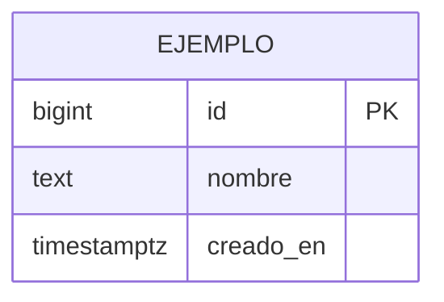

# Modelo de datos — ms-recursos

**Motor:** PostgreSQL en el RDS compartido
**Database:** `ppm_recursos`
**Schemas:** `t_acme`, `t_globex`, `t_initech` (uno por tenant)

Patron del enunciado: **Single Database, Multiple Schemas**. Las tres copias del
esquema son identicas; lo que cambia son los datos.

## Diagrama entidad-relacion

> TODO(@sebastianperez72): reemplazar por tu ER. Usa mermaid para que se vea en GitHub y
> se pueda pegar en el informe.



## Tablas

| Tabla | Para que | Registros aprox. por tenant |
|---|---|---|
| | | |

**Total por tenant:** 10,000 · **Total del microservicio:** 30,000

## DDL

```sql
-- seed/esquema.sql
```
